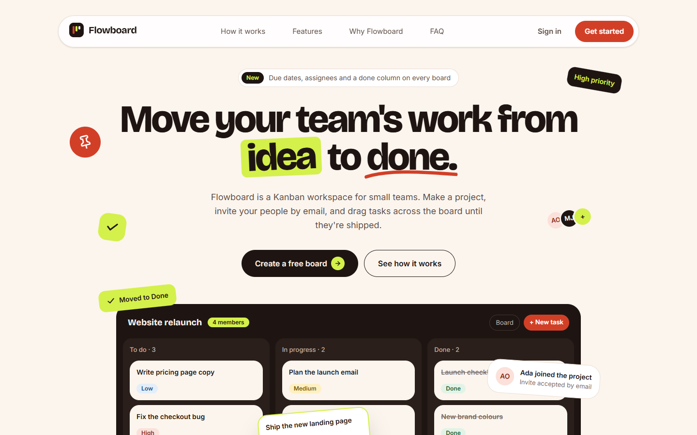
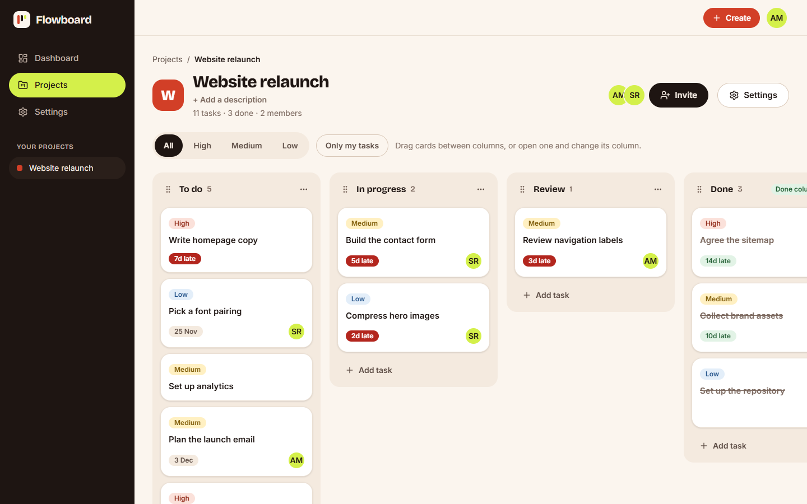
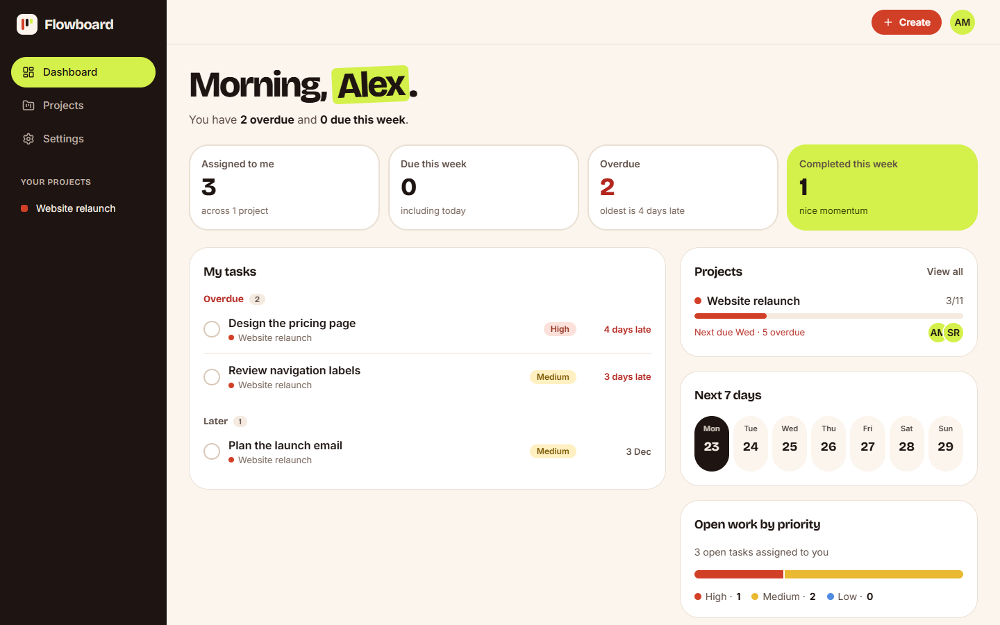

# Flowboard

A Kanban workspace for small teams (2–10 people). Make a project, invite your people by email, and drag tasks across the board from idea to done.



| The board                                                                                        | The dashboard                                                                                                             |
| ------------------------------------------------------------------------------------------------ | ------------------------------------------------------------------------------------------------------------------------- |
|  |  |

## Features

- **Boards that move.** Drag cards between columns and reorder them with a mouse, touch or the keyboard. Changes show at once and roll back if the server says no.
- **Tasks with the details that matter.** Priority, due date, assignee and description, edited in a side drawer whose state lives in the URL, so a task link can be shared. Every change is recorded in the task's activity history.
- **Pinning.** Pin the projects you use most to the top of the sidebar; recently opened ones follow.
- **Your own column order.** Members can arrange the columns the way they like without changing anyone else's board. The owner's order is the team order, and "Your order" resets yours to it.
- **Member column permissions.** The owner decides whether members may add columns, and how many in total.
- **Invites by email.** The owner invites people by address. The link works once, only for that address, and expires; invites can be resent or cancelled.
- **The dashboard.** What's assigned to you, what's due this week and what's overdue, progress per project, the next 7 days, and your open work by priority.
- **Accounts.** Email and password or GitHub sign-in, password reset by email, and changing your password signs you out on every other device.

## Stack

Next.js (App Router) · React · TypeScript · Redux Toolkit and RTK Query (Redux Toolkit Query) · Prisma and PostgreSQL on Neon · Auth.js v5 · dnd-kit · Tailwind CSS v4 · shadcn on Radix UI · React Hook Form and Zod · Nodemailer · Vitest and Testing Library · GitHub Actions · Vercel.

## How it's built

**One app, with a clean line between front and back.** The backend lives in the same Next.js app, in a shape that could move to a separate server later:

- `src/app/api/**/route.ts`: thin route handlers. Each one reads the request, checks the session, validates the body with Zod and calls a service. They never touch the database.
- `src/server/<feature>/<feature>.service.ts`: all business logic and Prisma queries. Every service that changes data writes an activity row in the same transaction.
- Errors always come back as `{ error: { code, message, fields? } }`, and every write returns the updated object.
- Projects you're not a member of return 404, not 403, so the API never reveals that they exist.
- Invite and password-reset tokens are stored only as hashes.

**Shared validation.** One Zod schema in `src/models/validations/` validates both the form in the browser and the body in the route handler.

**Server data in one place.** All server data lives in the RTK Query cache (`src/services/`, one file per backend area, injected into one base API in `src/configs/serviceConfig.ts`). It is never copied into component state. Moves, edits, pinning and reordering are optimistic: the cache updates at once and rolls back if the request fails. One error wrapper shows the error toasts.

**Positions the server owns.** The browser never sends task or column position numbers. It says "put this after that one", and the server works out the number.

**Tests and CI.** Vitest and Testing Library, with each test next to the code it tests (`<name>.test.ts`). Tests never touch the network, a database or `.env`: Prisma, `fetch` and email are mocked, and the time zone is fixed to America/New_York so date code can't pass by luck. GitHub Actions runs a format check, lint, typecheck, the tests and a production build on every push.

## Running it locally

You need Node.js 24, pnpm (the version in `package.json`'s `packageManager` field) and a PostgreSQL database. A free [Neon](https://neon.tech) project works well.

```bash
pnpm install
cp .env.example .env   # then fill it in (see below)
pnpm db:migrate        # creates the tables
pnpm dev               # http://localhost:3000
```

### Environment variables

Every variable is listed, with comments, in [`.env.example`](.env.example).

| Variable                               | What it is                                                                                                                      |
| -------------------------------------- | ------------------------------------------------------------------------------------------------------------------------------- |
| `DATABASE_URL`                         | Pooled Postgres connection, used by the app.                                                                                    |
| `DIRECT_URL`                           | Direct Postgres connection, used by the Prisma CLI (migrations, seed).                                                          |
| `AUTH_SECRET`                          | Signs session tokens. Generate one with `pnpm dlx auth secret`.                                                                 |
| `AUTH_TRUST_HOST`                      | `true` for `pnpm start` locally (Vercel sets it automatically).                                                                 |
| `AUTH_GITHUB_ID`, `AUTH_GITHUB_SECRET` | A GitHub OAuth app with the callback `http://localhost:3000/api/auth/callback/github`.                                          |
| `AUTH_GOOGLE_ID`, `AUTH_GOOGLE_SECRET` | Optional. A Google Web OAuth client (see [docs/google-signin-setup.md](docs/google-signin-setup.md)). Without them, "Continue with Google" is hidden. |
| `EMAIL_USER`, `EMAIL_PASS`             | A Gmail address and a Google App Password. Leave both empty locally and emails are printed in the terminal instead of sent.    |
| `APP_URL`                              | The public address, used in email links and metadata. Optional with `pnpm dev`; set it to `http://localhost:3000` for `pnpm start`. |
| `ALLOW_DB_RESET`                       | Local only. `db:seed` and `db:reset` refuse to run unless it is `true`.                                                         |

### Database commands

| Command           | What it does                                                                                                                       |
| ----------------- | ---------------------------------------------------------------------------------------------------------------------------------- |
| `pnpm db:migrate` | Applies the migrations to your database (and creates new ones during development).                                                |
| `pnpm db:seed`    | **Wipes the database** and fills it with demo data. Sign in as `demo@example.com` or `sam@example.com`, password `Flowboard123!`. |
| `pnpm db:reset`   | **Wipes the database**, runs every migration again, then seeds.                                                                    |

The seed and reset commands print the database host first and refuse to run unless `ALLOW_DB_RESET=true` is set in your `.env`. Never set it anywhere but your own machine.

### Checks

```bash
pnpm lint
pnpm typecheck
pnpm test
pnpm build
```
